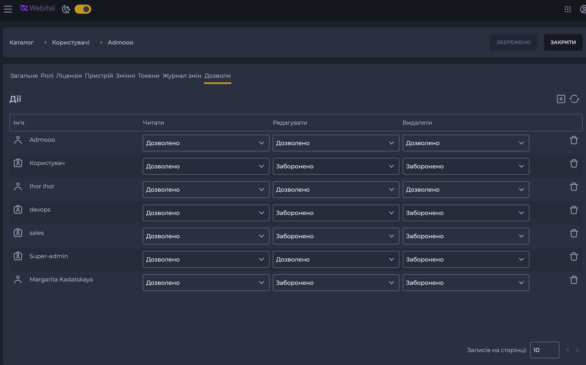

# Permissions: таба пермішенів (ACL обʼєкта)

Таба з правами доступу до обʼєкта в карточці сутності: хто (роль або користувач)
що може робити з цим обʼєктом — створювати, читати, редагувати, видаляти.



Усе для неї — в одному місці:

```ts
import { … } from '@webitel/ui-datalist/permissions';
```

## З чого складається

| Шар | Що | Де |
|---|---|---|
| апі | `getPermissionsList` / `patchPermissions` в апі сутності | `@webitel/api-services/api` (`generatePermissionsApi`) |
| енуми, логіка | `AccessMode`, `AccessRuleName`, `AccessRuleColumn`, `resolveGrants` | `@webitel/api-services` (`enums`, `scripts`), реекспортуються звідси |
| стан | `createPermissionsStore` — pinia стор на базі table store | `@webitel/ui-datalist/permissions` |
| UI | `PermissionsTab` — готова таба (таблиця, пагінація, попап додавання ролі) | `@webitel/ui-datalist/permissions` |
| переклади | `access.*` | `@webitel/ui-sdk` (локалі) |

## Як використовувати

### 1. Апі

Пермішени належать карточці і будуються однаково — дописуванням `/acl` до URL
сутності. Тому в апі сутності достатньо розгорнути `generatePermissionsApi`:

```ts
// api-services/src/api/clients/teams/teams.ts
export const TeamsAPI = {
	getList,
	get,
	// ...
	...generatePermissionsApi(baseUrl), // getPermissionsList + patchPermissions
};
```

Детально — в [generatePermissionsApi.js](../../ui-sdk/api/clients/_shared/generatePermissionsApi.js.md).

### 2. Стор

```ts
// <entity>/stores/permissions/teamsPermissionsStore.ts
import { TeamsAPI } from '@webitel/api-services/api';
import { createPermissionsStore } from '@webitel/ui-datalist/permissions';

export const useTeamsPermissionsStore = createPermissionsStore(
	`${TeamsNamespace}/permissions`,
	{
		apiModule: TeamsAPI,
	},
);
```

`apiModule` — апі сутності як є: стор сам бере з нього `getPermissionsList`
(для таблиці) і `patchPermissions` (для зміни прав).

### 3. Роут

`PermissionsTab` реєструється в роутері **напряму** як компонент таби. Роутинг
завішаний на параметрі `permissionId` — по ньому відкривається попап додавання ролі.

```ts
import { PermissionsTab } from '@webitel/ui-datalist/permissions';

{
	path: 'permissions/:permissionId?',
	name: TeamsRouteNames.PERMISSIONS,
	component: PermissionsTab,
}
```

### 4. Пропси з карточки

Карточка передає табі стор, права і `parentId` через `router-view`:

```vue
<router-view v-slot="{ Component }">
  <component
    :is="Component"
    v-bind="permissionsStoreData"
  />
</router-view>
```

```ts
const permissionsStoreData = computed(() => ({
	store: useTeamsPermissionsStore,
	access: {
		read: hasReadAccess.value,
		create: hasCreateAccess.value,
		update: hasUpdateAccess.value,
		delete: hasDeleteAccess.value,
	},
	parentId: itemId.value, // з card store, не з route.params
}));
```

> [!TIP] Пропс `access`
> Керує тим, що користувач може робити в табі: `read` — бачити табу,
> `create` — додавати роль (кнопка «+» в action bar), `update` — міняти права
> в селектах. Типізований як `PermissionsUserAccess`, за замовчуванням усе `false`.

## Колонка Create (`x`)

Звичайна таба має колонки Read / Edit / Delete. Якщо ACL сутності має ще
й правило створення (наприклад, OBAC класів обʼєктів), передайте
`headersWithCreate` — колонка Create зʼявиться сама:

```ts
import {
	createPermissionsStore,
	headersWithCreate,
} from '@webitel/ui-datalist/permissions';

export const useObjectsObacStore = createPermissionsStore(
	`${ObjectsNamespace}/obac`,
	{
		apiModule: ObjectClassesAPI,
		headers: headersWithCreate,
	},
);
```

## Нестандартний ACL

Якщо рядок ACL виглядає інакше або patch іде на інший URL, `createPermissionsStore`
не підійде. Тоді — `createTableStore` + своя таба, зібрана з деталей цього модуля:
`PermissionsRoleRow`, `PermissionsRoleSelect`, `AccessRuleColumn`,
`useAccessModeOptions`, `resolveGrants`.

Приклад — RBAC класів обʼєктів (рядок має ще `grantor`, patch іде на
`/acl/objclass/:id/grantor/:grantorId`): `client/src/modules/permissions/modules/objects/modules/rbac/`.

## Що експортується

| Експорт | Що це |
|---|---|
| `PermissionsTab` | готова таба: стор + `PermissionsTabContent` + пагінація |
| `PermissionsTabContent` | сама таблиця з селектами прав, без стану (усе через пропси) |
| `PermissionsRolePopup` | попап додавання ролі (відкривається по `permissionId` в роуті) |
| `PermissionsRoleSelect` | селект ролей з іконкою роль / користувач |
| `PermissionsRoleRow` | рядок «іконка + назва ролі» |
| `createPermissionsStore`, `permissionsStoreBody` | фабрика стору і його тіло |
| `headers`, `headersWithCreate` | колонки таби: без і з Create |
| `useAccessModeOptions` | опції селекта прав і рядки з перекладеними назвами прав |
| `AccessMode`, `AccessRuleName`, `AccessRuleColumn`, `resolveGrants` | реекспорт з `@webitel/api-services` |
| `PermissionEntity`, `PermissionGrantee`, `PermissionAccessRule`, `ChangeAccessModePayload`, `PermissionsChange`, `RawPermissionsApiModule`, `PermissionsUserAccess` | типи |
| `DEFAULT_PERMISSIONS_USER_ACCESS` | `access` за замовчуванням (усе `false`) |

## Як рахуються права (`resolveGrants`)

Кожне право — літера в рядку `granted`: одна — «дозволено», дві — «дозволено
з делегуванням». У patch йде те, що треба переключити:

```
 has | patch | got
-----+-------+-----
   - |  w    | w
   w |  w    | -
   - |  ww   | ww
   w |  ww   | ww
  ww |  ww   | w
  ww |  w    | -
```
